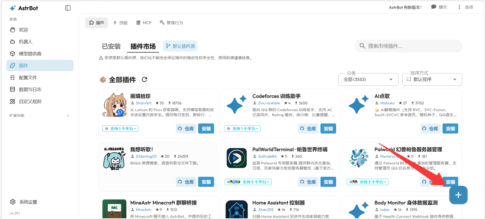
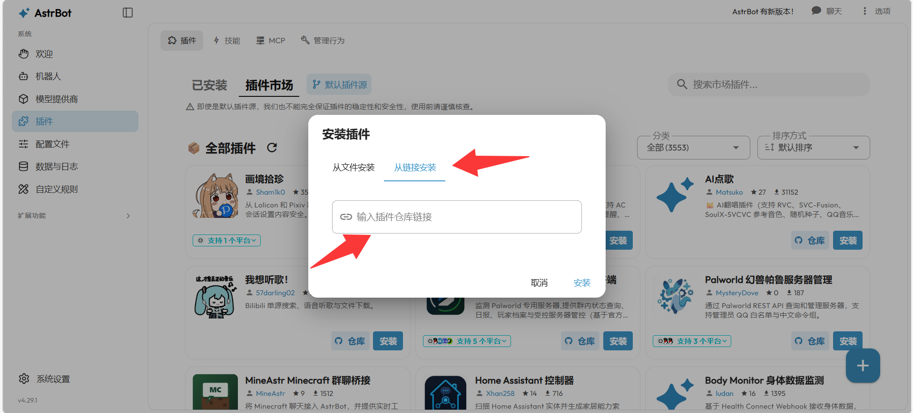
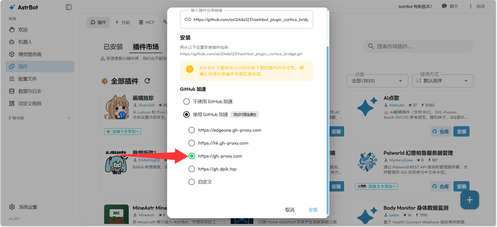

# Coo × AstrBot 新手图文教程

跟着这份教程安装两端扩展，先让 Coo 在 QQ 私聊里回你一句。私聊跑通后，再决定要不要开放群聊、Discord、图片、语音或 AstrBot 工具。全程可以在图形界面完成。

**版本说明**。教程以 AstrBot 桥和 Coo 扩展 **1.3.11** 为准。Discord 和两端的平台实例联动需要配套版本。已安装 AstrBot 桥 **1.3.9** 的用户可以继续接 QQ，下面也标有旧界面的入口。请在安装后先核对自己的版本号。 [AstrBot 桥发布页](https://github.com/as124da1231/astrbot_plugin_cortico_bridge/releases) · [Coo 扩展版本](https://www.npmjs.com/package/cortico-world-astrbot?activeTab=versions)

[安装 AstrBot 插件](#2-在-astrbot-安装桥插件) · [安装 Coo 扩展](#3-在-coo-安装客户端扩展) · [同机或跨机连接](#4-接通两端) · [发第一条 QQ 消息](#5-绑定主人并发第一条-qq-私聊) · [切完整模式](#6-需要群聊时再切完整模式) · [AstrBot 设置](#7-astrbot-侧的每个设置怎么用) · [Coo 设置](#8-coo-侧的每个设置怎么用) · [故障排查](#9-连接了却不回复先看这里)

如果你只想先聊起来，顺序是 **装 AstrBot 桥 → 装 Coo 扩展 → 填地址并连通 → 绑定自己的 QQ → 用这个 QQ 私聊机器人**。测试私聊时，群名单、图片模型、语音和工具先用默认值。

## 1. 开始之前

| 你需要的东西 | 怎么知道它已准备好 |
| --- | --- |
| AstrBot 4.29.1 或更新版本 | 能打开 AstrBot 网页后台，并进入左边的「机器人」「插件」页面。 |
| AstrBot 已接入一个能接收消息的 QQ 机器人 | 在 AstrBot「机器人」页能找到对应 OneBot v11 实例。给机器人发一条消息，在 AstrBot 能看到入站事件。若还没有实例，先按 [AstrBot OneBot v11 接入文档](https://docs.astrbot.app/platform/aiocqhttp.html) 完成这一步。 |
| 运行正常的 Coo | 在 Coo 桌面给它发一句话，确认现有模型能正常回答。后面 QQ 里也会使用这套人格和模型。 |
| 自己的 QQ 和机器人 QQ | 你用「自己的 QQ」给「机器人 QQ」发消息。这两个号码在下面的步骤里各有用途。 |

整个链路可以记成 `你的 QQ → QQ 机器人 → AstrBot → Coo`，然后回复沿原路回来。NapCat 等 OneBot 程序和 AstrBot 之间已有的地址、端口、令牌继续照常使用。教程里新建的「桥接令牌」用于 **Coo 连 AstrBot 桥**。

## 2. 在 AstrBot 安装桥插件

1. 打开 AstrBot，点左边「插件」，再点右下角蓝色 **＋**。

   

2. 在弹窗上方选「从链接安装」，把下面这行完整粘到「输入插件仓库链接」。

   ```text
   https://github.com/as124da1231/astrbot_plugin_cortico_bridge.git
   ```

   

3. 如果 AstrBot 所在的机器能直连 GitHub，选「不使用 GitHub 加速」。如果安装下载失败，再选「使用 GitHub 加速」，挑你信任的下载线路，先点「测试代理连通性」。截图展示的是选择方式，截图里的线路只是示例。选好后点右下角「安装」。

   

4. 回「已安装」确认能找到桥插件。新版显示「Coo 桥控制台」，旧版可能显示「Cortico 桥控制台」。确认插件已启用，展开 AstrBot 左侧的「扩展功能」打开控制台。若刚装完还没看到入口，刷新 AstrBot 后台，再到插件详情确认已加载。

**两处开关都要看。** AstrBot「已安装」卡片上的开关负责加载插件。桥自己的「接管对话」负责启动桥的监听并决定是否交给 Coo。初次安装，接管对话通常需要手动打开。

## 3. 在 Coo 安装客户端扩展

1. 打开 Coo 的高级设置，进入「扩展」或「扩展市场」。搜索 `cortico-world-astrbot` 或 `AstrBot`，安装作者 **as124da1231** 的 AstrBot 扩展并启用。扩展列表显示的名称可能是「AstrBot」或「AstrBot · QQ」。
2. 进入这个扩展的「连接」页。这里用来填桥地址、令牌和发起模式切换。新版还有「平台」页，可以查看 AstrBot 上报的 QQ、Discord 实例。
3. 如果已安装但无法找到面板，先确认扩展已启用、安装版本与当前 Coo 兼容。若扩展页提示重启生效，先保存 Coo 中的编辑再重启。[Coo 项目](https://github.com/Pal-AI-Lab/Coopanion) · [AstrBot 客户端扩展仓库](https://github.com/as124da1231/cortico-world-astrbot)

## 4. 接通两端

AstrBot 侧先打开「Coo 桥控制台 → 连接」。旧版在插件通用配置里找「接管对话」「监听地址」「监听端口」，在控制台「概览 → 谁能连进来」找访问令牌。按下面三种情况选一种。

### 情况 A：Coo 和 AstrBot 都直接运行在同一台电脑

1. AstrBot 侧开启「接管对话」，监听范围选「仅本机」，监听端口保留 `17999`，保存。等价的监听地址是 `127.0.0.1`。
2. Coo 侧协议选 `WS`，桥地址填 `ws://127.0.0.1:17999`。只做同机回环基础聊天时，令牌可以留空。
3. 点「保存并应用」。两边应显示「已连接」，Coo 应显示桥接模式已同步。

### 情况 B：AstrBot 跑在服务器上，或者和 Coo 不在同一个网络空间

1. 在 AstrBot「访问令牌」点「生成（轮换）」并复制。先生成令牌，再开启非回环监听。
2. 走直连时，在 AstrBot 选择「跨机 · 所有 IPv4 接口」，或选「指定地址」并填 Coo 能到达的监听接口。端口默认 `17999`。部署在防火墙、云安全组或 Docker 后面时，确认来自 Coo 的连接能到这个端口。尽量只对实际会连接的设备、地址范围或私网开放。
3. 在 Coo 填 `ws://服务器IP:17999`，再把刚复制的桥接令牌粘到专用字段，保存。请把 `服务器IP` 换成你的地址。`0.0.0.0` 是服务端表示监听所有 IPv4 接口的写法，Coo 应填写实际可访问的 IP 或域名。

`ws://` 可以跨机，也可以用 IP 直连。它的 WebSocket 流量本身是明文，令牌只验证来访者。经过公网时，优先使用下一种方案或已加密的私网隧道。

**Docker 容易踩坑**：即使 AstrBot 和 Coo 在同一台物理电脑，容器里的 `127.0.0.1` 也是容器自己。Coo 跑在宿主机时，从宿主机实际能访问的已映射端口连接。容器里的桥通常需要监听容器网卡并配置令牌，宿主机的端口映射可以按需要只绑定回环。若两者都在容器里，使用它们共同网络中可达的服务名或地址。

### 情况 C：已经有能转发 WebSocket 的 HTTPS 反向代理

1. 让代理把桥接地址转发给 AstrBot 桥，并转发 WebSocket 升级和 `Authorization` 请求头。代理与桥在同一网络空间时，桥可以继续监听 `127.0.0.1:17999`。
2. 在 Coo 填代理实际提供的地址，例如 `wss://bridge.example.com/astrbot-bridge`，并填桥接令牌。这个路径取决于你配置的代理，示例路径可按实际替换。
3. 证书要覆盖 Coo 地址里填写的域名或 IP，且受 Coo 信任。`wss://` 的证书和 TLS 由部署侧代理配置。浏览器能打开 AstrBot 控制台，只能证明后台端口可达，还要确认 WebSocket 的入口也能连通。

## 5. 绑定主人并发第一条 QQ 私聊

1. 在 AstrBot 打开「Coo 桥控制台 → QQ → 接管实例」。下拉选择已经在 AstrBot 配好的 QQ 机器人实例。只有一个且已选中时，可以直接使用。`default`、`default1` 等是实例 ID，用它来区分不同机器人连接。
2. 往下找到「主人私聊」。在「主人 QQ」下拉里选**你发消息用的个人 QQ**，名单里没有就选「手动指定 QQ」并填自己的 QQ 号。接着选择接收这条私聊的「QQ 机器人实例」，点「保存授权」。旧版的主人设置在控制台「概览」。
3. 在 Coo「连接」确认显示已连接、模式已同步。新安装默认从安全模式开始。已有启用的旧版部署升级后可能沿用原来的权限，请以实际显示的模式为准。
4. 用刚绑定的个人 QQ 私聊机器人，例如「你好，请回复我‘桥接成功’」。新版可以在 AstrBot「消息记录」查看这条消息和回复是否通过桥。

| 这几个身份是什么 | 举例怎么选 |
| --- | --- |
| 机器人 QQ | 从 QQ 里收到消息，并用这个号发出回复。由 AstrBot「机器人」页面的接入管理。 |
| 主人 QQ | 安全模式下能在 QQ 接续 Coo 主会话的个人 QQ。填你自己的发件人号码。 |
| AstrBot 管理员 | AstrBot 全局管理员名单里的账号。桥把这份名单拿来做下拉候选。主人可以是普通 QQ。若还要让 Coo 桌面对话以主人身份调 AstrBot 工具，这个主人必须同时在全局管理员名单内。 |

## 6. 需要群聊时，再切完整模式

| | 安全模式 | 完整模式 |
| --- | --- | --- |
| 平台哪些人能接入 | 只接已绑定的 QQ 主人私聊，以及已启用并绑定的 Discord 主人私信 | QQ 按管理员配置的群聊和私聊范围接入。Discord 按已放行频道和绑定的主人私信接入。 |
| Coo 能做什么 | 回复当前会话，按需读该会话内它已见过的历史及可取得的引用、转发、图片、语音 | 继续聊天和按权限读资料，也能使用已获授权的 AstrBot 工具。桌面调用主人工具、桌面主动发送按各自开关单独授权。 |
| 使用哪段对话 | Coo 主会话，主人能接着桌面聊 | 同一个 Coo 主会话。已放行群或私聊里，回复可能提到 Coo 桌面聊过的内容。 |

1. 在 Coo「连接 → 桥接模式」点「切换为完整模式」，阅读弹窗后发起申请。
2. 在 AstrBot「Coo 桥控制台 → 连接」找到审批。旧版在「概览」。这里会列出实际要开放的群、私聊、工具和桌面权限。**看清清单再勾选确认**，并点击「批准完整模式」。两端同步后才生效。
3. **如果清单显示全部群或所有私聊，而你只想放行指定会话**，先驳回。公开的 1.3.9 可以在 AstrBot「插件 → 已安装 → 桥插件的齿轮」先设置「群范围」「指定群名单」「私聊策略」和「私聊白名单」，保存后再发起申请。1.3.11 的安全模式会隐藏群聊和私聊页。如果审批前无法在界面缩小范围，请保持安全模式，让部署管理员先准备一份受限的名单。审批页显示的范围符合预期后再批准。
4. 已批准并同步后，在「QQ → 群聊范围」「QQ → 私聊范围」检查、保存实际名单。用测试群 @ 机器人发一句「请回我一句测试成功」。同时从名单外会话验证不会被交给 Coo。
5. 想收回开放面，在 AstrBot「连接」或 Coo「连接」切回安全模式。配置过的完整模式名单仍会保留，下次申请时可在审批清单复核。

> 为什么一定要看审批清单？空白的旧名单可能按「全部群」处理，私聊默认策略也可能显示「所有私聊」。第一次开完整模式时，以审批列出的实际范围为准。

## 7. AstrBot 侧的每个设置怎么用

### 7.1 连接

| 设置 | 初始值或建议 | 什么时候用 |
| --- | --- | --- |
| 接管对话 | 新装默认关闭 | 开启后桥才会监听并接管获准入站消息。关闭后停止桥接。断线时正常消息可回到 AstrBot 原有处理链，实际是否应答仍由 AstrBot 自己的设置决定。 |
| 监听范围 | 仅本机 | `127.0.0.1` 供直接同机连接。跨机选所有 IPv4 接口或指定接口，先生成令牌。「指定地址」里填有效 IP 或主机名。 |
| 监听端口 | `17999` | 两端直连端口要对上。若 Coo 经过端口映射或 WSS 代理，Coo 填外部映射或代理端口。改监听会要求确认，现有连接可能短暂中断。 |
| 每分钟发送上限 | `30`，`0` 表示不限 | 限制桥发送频率，避免连续发太多消息。初次使用保留 `30`。 |
| 访问令牌 | 新装为空 | 「复制」取出当前令牌，「生成（轮换）」生成新值，「清除」删掉当前值。轮换后更新 Coo 里的令牌再重连。清除后非回环桥可能无法启动；只准备免令牌回环连接时才考虑清除。令牌请只填专用输入框。 |
| 桥接模式 | 新装通常从安全模式开始 | 批准完整模式、驳回待审批申请、切回安全模式。模式显示已同步后才开始验证 QQ 或 Discord。 |
| 重开监听 | 排查时使用 | 让 AstrBot 端重新拉起监听。想让 Coo 重新连时，优先用 Coo「重新连接」。 |

### 7.2 QQ 接管与放行

| 设置 | 怎么填 | 生效行为 |
| --- | --- | --- |
| 添加 QQ 实例 | 从 AstrBot 已配置的实例下拉选择，至少保留一个 | 只有桥选中的实例会被接管。下拉标为 AstrBot 未启用的实例还需先在 AstrBot「机器人」启用。普通单实例沿用 `default` 的前提是机器人确实叫这个 ID。 |
| 群聊唤醒称呼 | 每行一个，例如 `Coo` 或一个不易撞到的昵称。留空也可以 | 在允许的群中匹配正文可唤醒 Coo。遇到称呼引起频繁响应时，删掉泛化词或清空称呼。 |
| 主人 QQ 和 QQ 机器人实例 | 个人 QQ 加上这条私聊所对应的实例 | 安全模式校验发送者和会话归属。换机器人实例后要重新检查绑定。配置了多个实例时，尤其要选对。 |
| 群聊范围 | 完整模式下建议先选「指定群」 | 「全部群」涵盖所接管 QQ 实例下的群。「指定群」只放行已填入名单的群，名单不能为空。 |
| 指定群名单 | 优先从最近识别到的群选择。手填时一行一个，单实例可用群号。多实例推荐完整会话标识 | 避免相同群号在多个接管实例下被同时放行。示例 `myqq:GroupMessage:123456789`，把 `myqq` 和群号换成实际值。 |
| 群消息范围 | 新手选「仅被叫」 | @ 机器人、引用或回复机器人的消息、正文命中称呼等可触发。`@全体` 不等于点名机器人。「全部消息」会把放行群的普通聊天也交给 Coo，可能增加模型用量及回复频率。AstrBot 命令仍走原有指令链。 |
| 私聊策略 | 选择「仅名单」并只加自己的 QQ，或关闭私聊 | 「关闭」不给 Coo 接 QQ 私聊。「仅名单」按白名单判断。「全部」允许能私聊机器人的 QQ 进入桥，适合明确接受共享主会话范围时使用。 |
| 私聊白名单 | 填个人 QQ 号，或完整会话标识 `myqq:FriendMessage:123456789` | 仅在「仅名单」下生效。完整模式下主人也要落在允许条件内，例如白名单包含自己的 QQ。 |
| 管理员私聊豁免 | 想只放行名单时关闭 | 只在白名单策略下有用。打开后，AstrBot 全局管理员即使没有列在私聊白名单也能进入 Coo。 |
| 被拒时 | 默认「静默忽略」 | 「静默忽略」不把被拒私聊交给 Coo。「交给 AstrBot」让 AstrBot 按原有模型和插件行为处理。这里配置的是完整模式下的私聊策略。 |

**UMO** 可以理解成 AstrBot 给每个会话分配的完整地址。`myqq:GroupMessage:123456789` 三段依次是机器人实例、群聊类型、群号。`FriendMessage` 后面填私聊的 QQ 号。界面能从最近会话下拉选的时候，选中后会自动填好。

### 7.3 桌面授权与 AstrBot 工具

| 设置 | 默认或建议 | 实际作用 |
| --- | --- | --- |
| 工具授权 | 默认空名单，按需勾选具体工具，再点「保存并同步」 | 仅完整模式启用。工具在 AstrBot 执行，仍受工具是否启用、实际发件人或桌面主人身份及 AstrBot 权限限制。勾选是一项授权，上游插件也要能正常工作。 |
| 已审查的工具风险 | 新工具默认按「执行」看待 | 可按工具实际行为标为「只读」「写入」或「执行」。风险分类会影响自动授权，请核对工具行为后再更改。工具名看起来像查询，也可能实际联网、发消息或修改数据。 |
| 自动授权已审查的读写工具 | 初次使用建议关 | 开启后等价于名单包含 `*`，只自动包含明确标为只读或写入的工具；执行类仍要明确点名。若将来更改新工具的风险分类，它也可能自动加入，因此适合已经审查过工具的部署。 |
| 允许 Coo 桌面对话以主人身份使用对应工具 | 默认关 | 完整模式、有效桥接令牌、主人是 AstrBot 管理员、工具已获授权，这几项都要满足。即使是本机，想使用这项桌面能力也需要在两端设同一枚桥接令牌。 |
| 桌面主动发送目标 | 默认空 | 授权 Coo 从桌面主动用**机器人身份**发送到指定会话。一个目标填一个完整 UMO，优先从已见过的会话选择。目标还须符合桥的接入策略。聊 QQ 时正常回到原会话，不需要先给所有群配置桌面主动发送。 |

### 7.4 Discord（两端 1.3.11）

1. 在 AstrBot「机器人」先配置 Discord 适配器。Discord 的 Bot Token 填在 AstrBot 的 Discord 适配器里，Coo 继续使用已有的桥接令牌。[AstrBot Discord 接入文档](https://docs.astrbot.app/platform/discord.html)
2. 在桥控制台「Discord → 机器人接入」选择实例，打开接入开关，填写主人的 **Discord 数字用户 ID**，保存。可通过 Discord 开发者模式复制用户 ID，使用数字 ID 才能区分重名账号。
3. 让这位主人给机器人发第一条私信完成真实会话绑定。看到「已绑定」后再发一条消息验证对话。换主人时会重新绑定。
4. 完整模式可保存指定频道，优先在控件里选择已见过的频道，也可填数字频道 ID 或所选实例的完整频道 UMO。频道里直接 @ 机器人验证。空频道名单不会开放频道。
5. 在 Coo「平台 → Discord」看实例状态。QQ 和 Discord 共用一条 AstrBot 桥连接，不需要为 Discord 再填一套地址或桥接令牌。

### 7.5 图片、引用和转发

| 图片处理 | 发生什么 |
| --- | --- |
| 自动（默认） | Coo 当前模型声明能读图时转交可用的图片，否则尝试让 AstrBot 的视觉模型转述。 |
| 发送原图 | 按用户选择尝试转交图片，即使 Coo 没声明读图能力。桥可能根据 AstrBot 的图片设置做大小处理。Coo 模型仍要支持接收图片才能实际看图。 |
| 视觉转述 | 由 AstrBot 视觉模型看图，Coo 收到文字描述。适合 Coo 使用纯文本模型但希望理解图片的情况。 |
| 关闭图片处理 | 消息可保留图片占位，桥跳过自动传图和视觉调用。 |
| 转述使用的模型 | 在「自动」或「视觉转述」下可选择 AstrBot 已有的模型。「自动选择」会尝试找名称符合视觉模型规则的提供商。遇到选错或找不到时，直接下拉选一个已验证能读图的模型。 |

QQ 的引用和合并转发可以请求 Coo 按需查看。图片、语音等能否取到，取决于 QQ 适配器是否拿到了可用附件、来源是否过期以及当前模型能处理的输入。测试时可以先发一张普通图片，再发一条带引用和一句「请看看我引用的这张图」。

### 7.6 语音

| 设置 | 新装默认 | 用法 |
| --- | --- | --- |
| 转写语音（STT） | 关闭 | 想让 Coo 收到 QQ 语音的**文字内容**就打开，并选择 AstrBot 已配置的 STT Provider。留空跟随 AstrBot 当前 STT Provider。STT 是语音转文字。 |
| 允许语音（TTS） | 关闭 | 想让 Coo 可以发语音回复就打开，并选择 TTS Provider。留空跟随 AstrBot 当前 TTS Provider。TTS 是把文字合成语音。只开启开关时，Coo 仍可选择发普通文字。 |
| 语音字数上限 | `120` 字 | 超过上限的语音回复退回文字，`0` 表示不限。新版界面可填 `0` 到 `1000`，旧版在插件通用配置里调整。 |
| 试听 | 手动按钮 | 先在网页里听合成效果。旁边的「发到最近的 QQ 会话」会真的发一条试听语音，点之前确认最近会话是你的测试私聊或测试群。 |

语音原文件和 STT 转写是两件事。只想让 Coo 理解说话内容时，先测 STT。想让 Coo 查看原文件时，可引用刚发送的语音，明确说「请读取这条语音的原文件」。文件能否取到取决于适配器和消息来源，Coo 模型能否直接理解音频则取决于模型自身。

## 8. Coo 侧的每个设置怎么用

| 设置 | 初始值或建议 | 说明 |
| --- | --- | --- |
| AstrBot 扩展启用状态 | 安装后确认已启用 | 负责 Coo 是否启动这条连接。AstrBot 的接管开关也要打开。 |
| 协议 | 同机默认 `WS` | 选择 `WS` 或 `WSS` 会改地址的开头。把完整 `ws://` 或 `wss://` 地址粘进去时，界面也会识别。 |
| 桥地址 | `ws://127.0.0.1:17999` | 指向 AstrBot 桥或转发它的代理。地址里填主机、端口及可选的代理路径。令牌放专用输入框。 |
| 桥接令牌（Token） | 同机回环基础聊天可以空 | 跨机填 AstrBot 生成的那一枚。设置过之后输入框继续显示空白，「已保存」才是状态。留空再保存会沿用已有值。真要删除时，点「清除已保存的令牌」并保存。 |
| 重连初始间隔 | `1000` 毫秒，也就是 1 秒 | 断线后第一次重试的等待时间。常用范围 `200` 到 `60000` 毫秒，首次安装保留默认。 |
| 重连上限 | `30000` 毫秒，也就是 30 秒 | 连续失败的等待时间会逐步变长，最多等到这个值。常用范围 `1000` 到 `600000` 毫秒。上限至少等于初始间隔。 |
| 带时间前缀 | 默认开 | 送给 Coo 的群或私聊内容会带类似 `19:30` 的标记，帮助它理解先后。不会强制在每条 QQ 回复前带时间。 |
| 回复时带渠道提示 | 默认开 | 提醒 Coo 这是一条平台消息、应该用哪个回复出口。桌面对话仍按桌面自己的方式回复。 |
| 允许 @全体成员 | 默认关，可通过高级配置字段 `worlds.astrbot.allowAtAll` 设置 | 仅影响 Coo 往 QQ 群发送时能否使用 @全体。普通 @ 成员与这个开关无关，入站的 @全体也不自动等于点名机器人。看不到按键时保持默认。 |
| 保存并应用、重新连接 | 按需 | 有地址、令牌或重连参数改动就先保存，保存后会尝试重连。只是断线或临时网络问题，可以点「重新连接」。 |
| 模式切换、运行详情、平台 | 用来操作模式或查状态 | Coo 侧发起完整模式申请，AstrBot 管理后台批准。工具、名单、主人和媒体设置在 AstrBot 侧调整，Coo 侧沿用同步到的结果。 |

## 9. 连接了却不回复，先看这里

| 你看到的现象 | 从哪一步查起 |
| --- | --- |
| AstrBot 也看不到 QQ 入站 | 先查 OneBot／QQ 机器人登录、AstrBot「机器人」连接和会话是否正确。桥要等 AstrBot 收到事件。 |
| Coo 一直「等待连接」 | 查看 AstrBot 的接管开关和监听状态。核对 Coo 地址、端口、Docker 映射、防火墙和云安全组。跨机填的是桥的地址，而不是 AstrBot 网页管理端口或 OneBot 端口。 |
| 提示令牌错误 | 在 AstrBot 桥控制台重新复制当前令牌，覆盖 Coo 输入框再保存。看清是否刚轮换、是否误用了 NapCat 或 Discord 的令牌。 |
| `wss://` 连不上 | 检查代理路由、WebSocket 升级及鉴权请求头是否转发，并检查证书是否覆盖所填主机且受 Coo 信任。 |
| 显示已连接，主人私聊不回 | 核对发送消息的个人 QQ、接收消息的机器人实例和主人绑定。完整模式还要核对「私聊范围」。如果通过 AstrBot 指令关闭了当前会话的 LLM 响应，比如 `/llm off`，按原来的指令方式恢复后再测。 |
| 私聊能回，群不回 | 看是不是安全模式，完整模式是否已批准并同步。检查群名单、所选实例和「仅被叫」，再试直接 @ 机器人。 |
| 群聊、私聊、工具页找不到 | 新版安全模式会收起仅完整模式启用的权限页。先看当前模式和安装版本，并在审批前核对开放范围。 |
| 平台显示没有实例 | 看 Coo 是否已连接、两端是否支持实例上报、AstrBot 是否已配置并启用相应机器人。旧桥基础 QQ 功能可用时，也可能缺少平台明细。 |
| 消息记录里有进无出 | 先测试 Coo 桌面本身是否能回复。桌面也不回时优先检查模型连接、并发和额度。桌面正常再看 Coo／AstrBot 日志里的该轮回执。 |
| 图片看不懂或语音没有文字 | 分别检查图片模式、Coo 模型是否读图、AstrBot 视觉模型或 STT Provider 是否可用。先用还未过期的一张图或一段短语音测试。 |
| AstrBot 指令还在执行 | 这是预期路径。AstrBot 的指令继续由 AstrBot 处理，可用普通私聊或 @ 机器人验证桥接。 |

在 QQ 群里求助时，发**两端版本、同机还是跨机、完整错误提示和在哪一步卡住**就够了。对截图中的桥接令牌、QQ 号、群号码、服务器地址和聊天内容做遮盖。

## 附录：配置字段对照

下面用于看旧截图、排查迁移或和别人对设置。日常优先使用上面的界面步骤。

| AstrBot 内部字段 | 初始值 | 对应入口或用途 |
| --- | --- | --- |
| `enabled` | `false` | 连接／接管对话 |
| `bridge_mode` | 空字符串 | 连接／已批准的模式。空值会按照新装或旧版已启用状态推导。 |
| `discord_routes` | `{}` | Discord／实例授权，内部记录启用状态、主人用户 ID、绑定的私信会话及频道名单。 |
| `bridge_platforms` | `["default"]` | QQ／接管实例 |
| `group_scope` | `inherit` | QQ／全部群或指定群，初始继承旧名单。 |
| `group_allow` | `[]` | QQ／指定群名单 |
| `group_mode` | `inherit` | QQ／仅被叫或全部消息，初始继承旧开关。 |
| `name_aliases` | `[]` | QQ／群聊唤醒称呼 |
| `listen_port` | `17999` | 连接／监听端口 |
| `listen_host` | `127.0.0.1` | 连接／监听范围或指定地址 |
| `token` | 空字符串 | 连接／访问令牌，由控制台生成和轮换。 |
| `max_sends_per_minute` | `30` | 连接／每分钟发送上限 |
| `owner_tool_qq` | 空字符串 | QQ／主人 QQ |
| `owner_platform` | 空字符串 | QQ／主人绑定的机器人实例，只有一个有效接管实例时旧值可推导。 |
| `desktop_tools_enabled` | `false` | QQ／桌面主人工具 |
| `desktop_send_targets` | `[]` | QQ／桌面主动发送目标 |
| `desktop_auth_reviewed` | `false` | 程序记录桌面权限迁移是否已确认。 |
| `owner_tool_token` | 空字符串 | 旧版桌面凭据迁移记录。新版桌面权限使用桥接令牌及服务端授权。 |
| `image_vision_provider` | 空字符串 | 图片／转述使用的模型，留空自动选择。 |
| `image_mode` | `auto` | 图片／处理方式 |
| `tts_enabled`、`tts_provider_id`、`tts_max_chars` | `false`、空字符串、`120` | 语音／允许语音、合成模型、字数上限 |
| `stt_enabled`、`stt_provider_id` | `false`、空字符串 | 语音／转写语音、转写模型 |
| `tools_allow`、`tools_risks` | `[]`、`[]` | 工具／授权名单、风险分类 |
| `private_mode`、`private_allow` | `all`、`[]` | QQ／私聊策略、白名单，只在完整模式参与放行。 |
| `private_admin_bypass`、`private_deny` | `true`、`ignore` | QQ／管理员私聊豁免、被拒时的行为 |
| `observe_all`、`observe_groups` | `false`、`[]` | 旧群聊开关和名单兼容字段。使用界面保存新群范围，程序会同步处理旧值。 |

Coo 客户端字段位于 `worlds.astrbot` 下：`enabled` 对应扩展启用，`wsUrl` 对应桥地址，`token` 对应桥接密钥，`includeTime` 和 `channelHint` 对应消息格式，`reconnectBaseMs` 和 `reconnectMaxMs` 对应重连设置，`allowAtAll` 对应 @全体。历史字段 `mode`、`nameAliases`、`maxSendsPerMinute` 留作旧配置兼容，日常改 AstrBot 侧对应设置即可。
